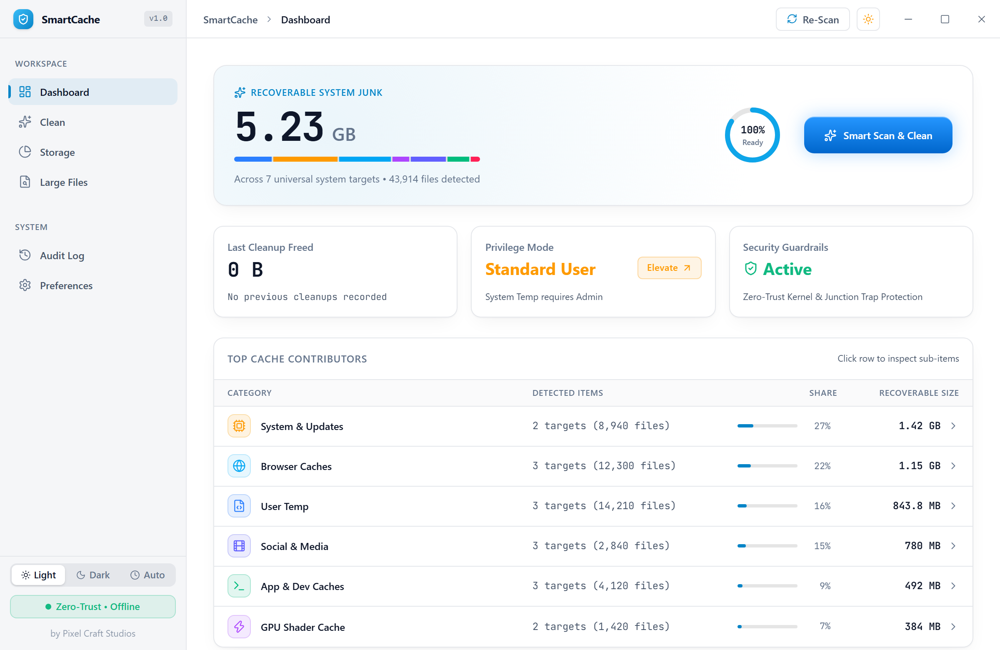
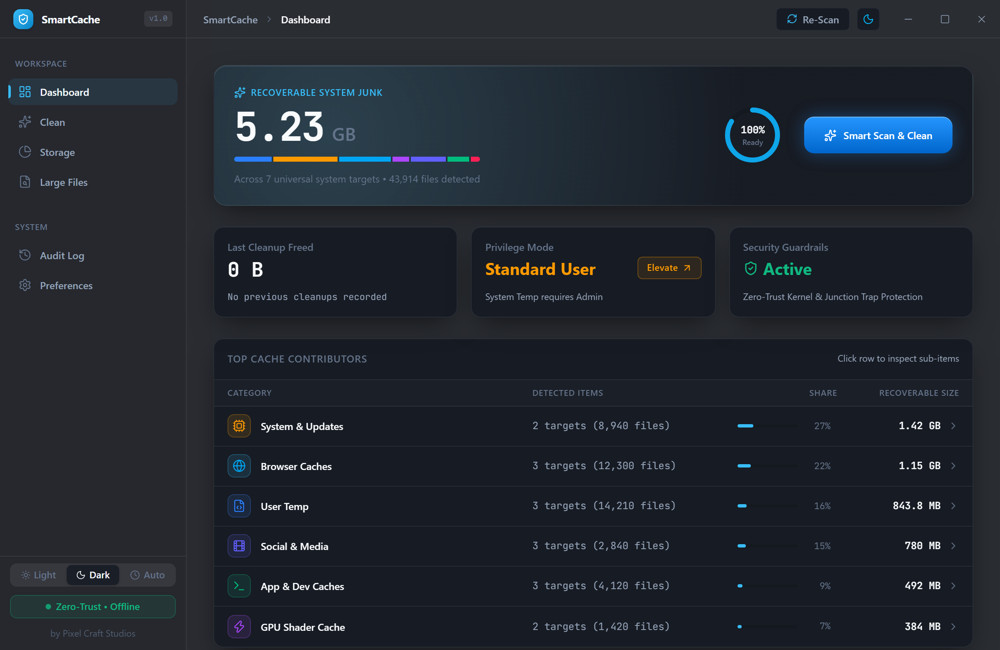
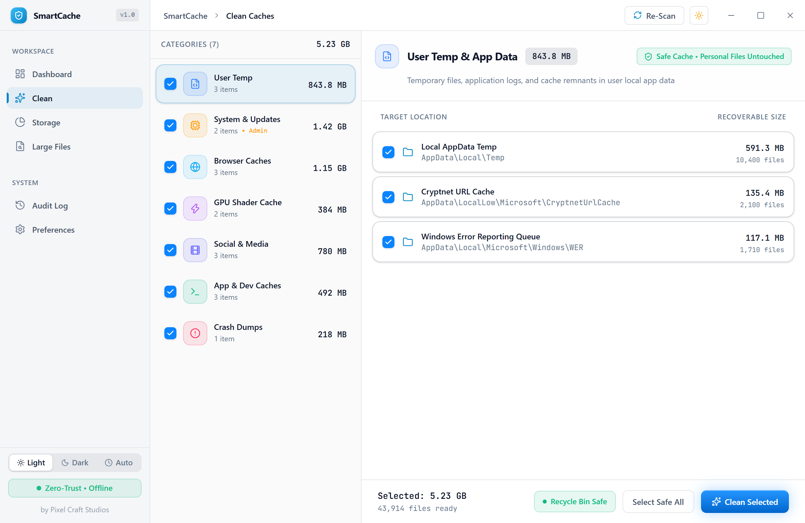
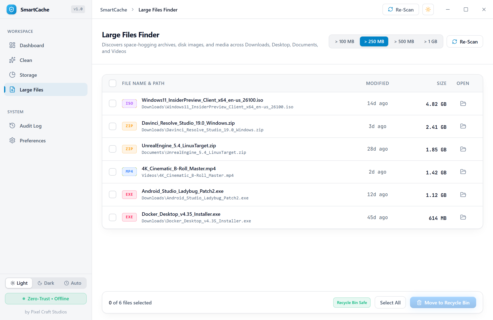

<div align="center">

# SmartCacheCleaner `v1.1.0`

### Zero-Trust, High-Speed Windows Cache & Junk Cleaner

[](https://github.com/nisitha/SmartCacheCleaner)
[](https://github.com/nisitha/SmartCacheCleaner)
[](https://v2.tauri.app)
[](LICENSE)

**Engineered by [Pixel Craft Studios](https://www.pixelcraftlk.com)**

<br/>

[-0284C7?style=for-the-badge&logo=windows&logoColor=white)](https://github.com/nisitha/SmartCacheCleaner/releases/latest/download/SmartCacheCleaner.exe)
&nbsp;
[](https://github.com/nisitha/SmartCacheCleaner/releases/latest/download/SmartCacheCleaner_0.1.0_x64-setup.exe)

<br/>
<br/>



</div>

---

## Dual-Theme Visual Experience

SmartCacheCleaner comes with two commercial-grade workspace themes inspired by Linear, Raycast, and CleanMyMac. An intelligent time engine switches automatically between **Porcelain Light** (6:00 AM – 6:00 PM) and **Obsidian Dark** (6:00 PM – 6:00 AM), with instant manual override via the sidebar pill.

| Porcelain Light Mode (Default) | Obsidian Dark Mode |
| :---: | :---: |
|  |  |
| Crisp high-contrast canvas with frosted glass bevels | Deep obsidian slate optimized for evening low-light sessions |

---

## Step-by-Step PC & Laptop Cache Cleaning Demo Guide

Follow this simple walkthrough to reclaim gigabytes of bloated temporary junk safely in under 30 seconds.

### Step 1: Instant Zero-Trust Scan
- Run `SmartCacheCleaner.exe` directly — zero installer required, 100% portable.
- In approximately **2–3 seconds**, the Rust engine audits seven universal cache zones:
  1. **User Temp & App Data** (`%LOCALAPPDATA%\Temp`, WER reporting, Cryptnet cache)
  2. **System Temp & Updates** (`C:\Windows\Temp`, SoftwareDistribution download cache)
  3. **Web Browser Caches** (Google Chrome, Microsoft Edge, Brave, Mozilla Firefox)
  4. **GPU & Shader Cache** (DirectX, NVIDIA DXCache/GLCache, AMD D3DSCache)
  5. **Social & Creative Media** (WhatsApp Desktop, Telegram media, CapCut, Adobe CC)
  6. **App & Dev Caches** (npm, pip, Cargo registry, Gradle)
  7. **Crash Dumps & Error Logs** (Memory minidumps, WER error reports)

---

### Step 2: Review & Inspect Cache Categories
- Click **Clean** in the left sidebar to enter the focused 3-column triage pane.
- Review granular sub-items, exact folder paths, file counts, and recoverable disk space.
- Uncheck any specific sub-item or click **Select Safe All** to highlight all standard-user caches.

<div align="center">



</div>

---

### Step 3: One-Click Safe Cleanup (Recycle Bin Protection)
- Click **Clean Selected** or **Clean All Safe** in the floating bottom dock.
- **Recycle Bin Safe Mode** is active by default: cleaned cache files are moved to the Windows Recycle Bin first, allowing recovery if needed.
- For maximum disk clearance on constrained SSDs, toggle **Permanent Deletion** in Preferences.
- Every cleaning session records a tamper-evident entry in the **Audit Log** (`%LOCALAPPDATA%\SmartCacheCleaner\audit.log`).

---

### Step 4: Optional Admin Elevation for Windows Update Cache
- Operating system level folders like `C:\Windows\Temp` and `C:\Windows\SoftwareDistribution\Download` require administrator access.
- Click the **Elevate** button on the Dashboard or Preferences screen to trigger the Windows UAC prompt.
- SmartCacheCleaner seamlessly relaunches elevated with admin rights so you can safely purge gigabytes of stale Windows Update installation packages.

---

### Step 5: Reclaim Extra Space with Large File Finder
- Click **Large Files** in the workspace sidebar.
- Filter space hogs across your **Downloads**, **Desktop**, **Documents**, and **Videos** folders using four dynamic size thresholds:
  - `> 100 MB`
  - `> 250 MB` (Default)
  - `> 500 MB`
  - `> 1 GB`
- Click the folder icon (**FolderOpen**) on any item to reveal and highlight the exact file in Windows Explorer.
- Select forgotten `.iso` disk images, massive video footage, `.zip` archives, or obsolete `.exe` installers, and send them to the Recycle Bin with one click.

<div align="center">



</div>

---

## 100% Safe by Design (Zero-Trust Guarantee)

SmartCacheCleaner was engineered from the ground up to prevent accidental data loss:

- **Personal Data Hard-Block:** Kernel-level path validators strictly block access to personal documents, photos, desktop shortcuts, and code repos (`Documents`, `Desktop`, `Pictures`, `Music`, `Videos` are never touched during cache cleaning).
- **Credential Protection:** Browser user credentials (`Login Data`, `Cookies`, `Web Data`, `Bookmarks`, `History`) are strictly excluded from scanning and deletion.
- **Telegram Session Security:** Telegram media scans exclusively target `tdata\user_data\cache` and `media_cache`. The root `tdata` authentication keys and active sessions are strictly blocked.
- **NTFS Reparse-Point / Junction Trap Defense:** Before evaluating or deleting any file or folder, the scanner checks the Win32 `FILE_ATTRIBUTE_REPARSE_POINT` (0x400) attribute. Directory traversal across NTFS junctions and symbolic links is halted immediately.
- **100% Offline & Private:** Zero telemetry, zero cloud trackers, and zero background network requests. The binary executes entirely offline.

---

## Technology Stack

| Layer | Component | Description |
| :--- | :--- | :--- |
| **Desktop Shell** | [Tauri v2](https://v2.tauri.app/) | Lightweight native desktop wrapper utilizing Microsoft Edge WebView2 |
| **System Engine** | [Rust 2021](https://www.rust-lang.org/) | High-concurrency safe filesystem scanner and Windows API controller |
| **Frontend UI** | React 19 + TypeScript | Modular, type-safe interface with zero Unicode emoji dependencies |
| **Styling** | Tailwind CSS v4 | High-performance CSS engine with custom DWM glass & bevel tokens |
| **Icons** | [Lucide React](https://lucide.dev/) | Consistent 1.75 stroke-width vector iconography |
| **Typography** | Fontsource | Bundled offline fonts: Plus Jakarta Sans (UI) & JetBrains Mono (metrics) |

---

## Local Compilation & Build Instructions

### Prerequisites
- [Node.js](https://nodejs.org/) (v18.x or v20.x recommended)
- [Rust & Cargo](https://rustup.rs/) (stable `x86_64-pc-windows-msvc`)
- Visual Studio 2022 with **Desktop development with C++**

### Clone & Install
```powershell
git clone https://github.com/nisitha/SmartCacheCleaner.git
cd SmartCacheCleaner
npm install
```

### Run in Development
```powershell
npm run tauri dev
```

### Production Build
```powershell
# Run security test suite
cargo test --manifest-path src-tauri/Cargo.toml

# Compile release executable and installer
npm run tauri build
```

Binary outputs:
- **Portable Executable:** `src-tauri/target/release/SmartCacheCleaner.exe`
- **Windows Setup Installer:** `src-tauri/target/release/bundle/nsis/SmartCacheCleaner_0.1.0_x64-setup.exe`

---

## License

This project is licensed under the [MIT License](LICENSE) — see the LICENSE file for details.

---

## Publisher & Commercial Support

**Pixel Craft Studios**  
Colombo, Sri Lanka  
- **Official Website:** [www.pixelcraftlk.com](https://www.pixelcraftlk.com)  
- **Direct WhatsApp Support:** [+94 78 767 6576](https://wa.me/94787676576)  
- **Commercial Inquiries:** contact@pixelcraftlk.com  
